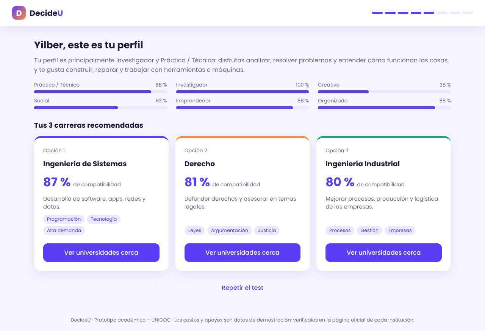

# DecideU

An AI-assisted vocational guidance app that helps young people decide what to study, with career recommendations, nearby universities, costs and scholarships.



## Main flow

1. Create an account.
2. Choose your location (GPS or town list).
3. Take a 12-question vocational test.
4. Get your top 3 careers with a compatibility percentage.
5. See the universities near you, on a map and ordered by distance.
6. Check the cost per semester and the scholarships, discounts and financial support you can get.
7. Save your plan.

## How to run

No installation needed.

1. Download or clone the repository:
   `git clone https://github.com/[user]/decideu.git`
2. Open the folder and double-click `index.html` (Chrome or Edge).

Optional, with a local server (needed for the GPS button in some browsers):

```
cd decideu
python -m http.server 8000
```

Then open http://localhost:8000

## Technologies

- HTML5, CSS3 and JavaScript (no frameworks)
- Leaflet + OpenStreetMap (map of universities)
- Browser Geolocation API (user location)
- localStorage (saves the user's results in the browser)
- Recommendation engine: RIASEC profile (Holland) + cosine similarity between the user profile and each career profile

## Project structure

```
decideu/
├── index.html   # screens of the app
├── styles.css   # design
├── data.js      # questions, careers, towns, universities and support programs
└── app.js       # logic: navigation, test, recommendations, map and costs
```

## Note about the data

This is an academic prototype. Costs, programs and support programs in `data.js` are demo data and must be verified on the official website of each institution.

## Team

- Yilber Andrey Achury Hoyos

## References

Bancolombia. (2025, October 30). *Causas y efectos de la deserción universitaria en Colombia y programas que emergen ante coyuntura*. Capital Inteligente. https://www.bancolombia.com/empresas/capital-inteligente/actualidad-economica-sectorial/impacto-desercion-universitaria-colombia

Holland, J. L. (1997). *Making vocational choices: A theory of vocational personalities and work environments* (3rd ed.). Psychological Assessment Resources.

Semana. (n.d.). *Las consecuencias de elegir mal la carrera*. https://www.semana.com/las-consecuencias-de-elegir-mal-la-carrera/201500/
